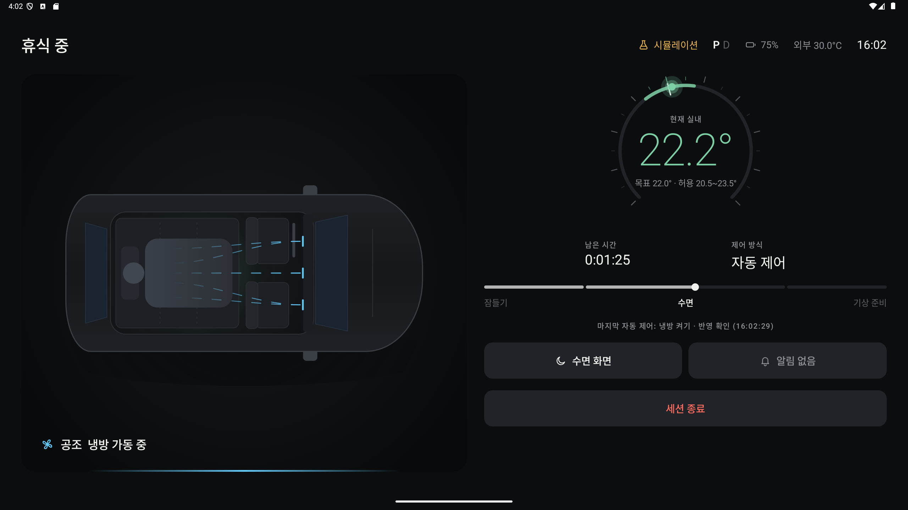
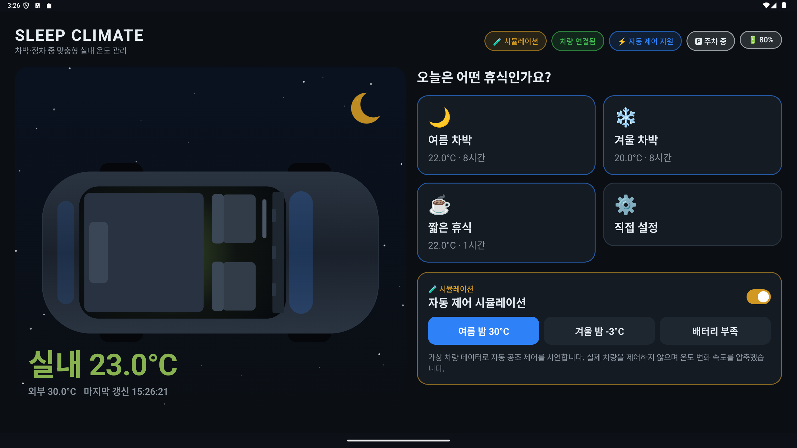
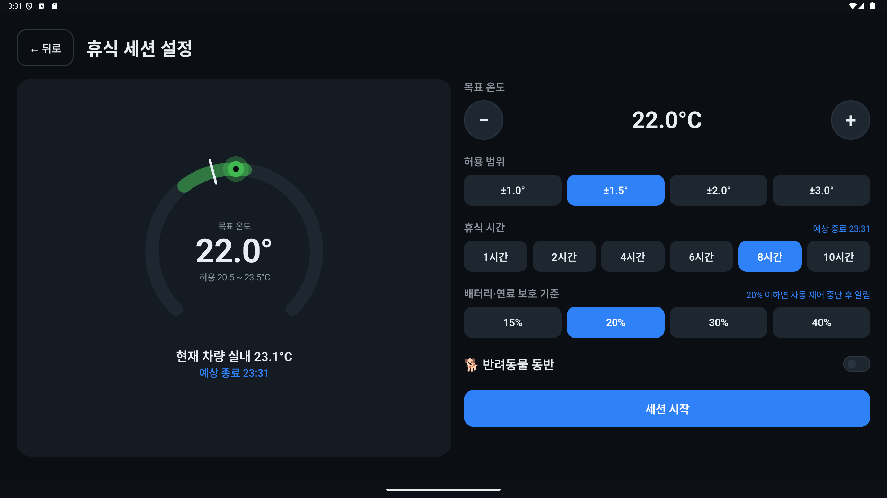
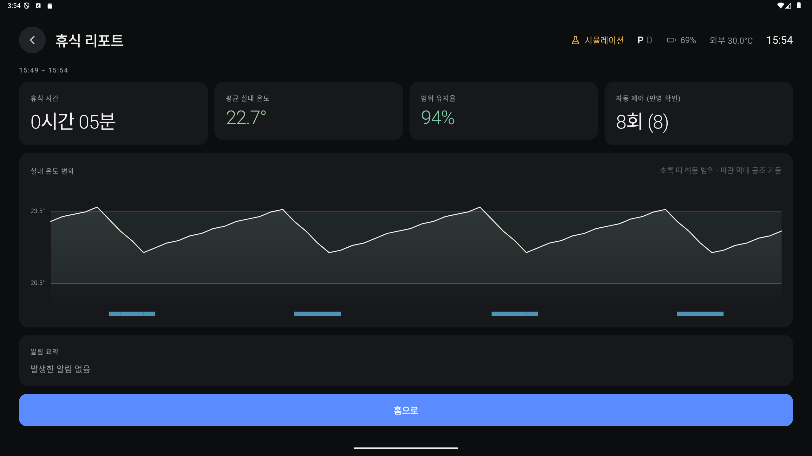

# SLEEP CLIMATE

차박이나 장거리 운전 중 차에서 쉴 때 쓰는 Pleos Connect 앱입니다.
잠들기 전에 목표 온도와 휴식 시간을 정해 두면, 자는 동안 실내 온도를 보면서 냉방·난방을 켜고 끄고, 배터리가 부족하거나 문제가 생기면 깨워 줍니다.



시연 영상(3분 52초): [demo/SleepClimate_시연영상.mp4](demo/SleepClimate_시연영상.mp4)
Pleos 차량 서비스가 없는 에뮬레이터에서 시뮬레이션 차량 데이터로 촬영했습니다.

## 만든 이유

차에서 자다 보면 새벽에 덥거나 추워서 깨고, 공조를 켜고 끄느라 잠이 끊깁니다. 그렇다고 공조를 켜 둔 채 자면 배터리가 걱정됩니다.
원격·예약 공조는 정해진 시간에 켜고 끄는 기능이라, "이 온도 범위로 7시까지 유지하고 배터리가 20% 아래면 멈춰 줘" 같은 걸 맡길 수 없었습니다. 그래서 휴식 한 번을 하나의 세션으로 묶어 관리하는 앱을 만들었습니다.

## 주요 기능

- 휴식 세션: 목표 온도, 허용 범위, 휴식 시간, 배터리 보호 기준을 한 번 설정. 홈의 여름 차박 / 겨울 차박 / 짧은 휴식을 누르면 값이 채워져 있습니다.
- 자동 공조 제어: 허용 범위를 벗어나면 냉방이나 난방을 켜고, 목표 온도가 되면 끕니다. 명령을 보낸 뒤 차량 상태에 반영된 것을 확인해야 성공으로 기록합니다.
- 보호 장치: 주차(P) 상태에서만 동작하고, 배터리·연료가 기준 아래로 내려가면 공조를 끄고 자동 제어를 멈춘 뒤 알립니다. 연결이 끊기거나 데이터가 오래되면 바로 알립니다.
- 수면·기상: 30초 동안 조작이 없으면 어두운 수면 화면으로 바뀝니다. 끝나기 10분 전부터 허용 범위를 좁혀 목표 온도에 맞추고 화면을 서서히 밝힙니다. 기상 화면에서 10분 연장할 수 있고, 반응이 없으면 5분 뒤 끝냅니다.
- 음성: "여름 차박 시작해줘", "온도 좀 올려줘", "지금 몇 도야", "10분만 더 잘게" 같은 말로 조작합니다. 음성 안내는 시작·기상·위험 알림 때만 나옵니다.
- 휴식 리포트: 밤사이 온도 그래프, 허용 범위 유지율, 자동 제어 횟수, 알림 내역.

| 홈 | 설정 | 리포트 |
|----|----|----|
|  |  |  |

화면은 차량 중앙 디스플레이(Devbox 2560×1440 가로)를 기준으로 만들었고, 2앱 분할 화면이나 폰처럼 폭이 좁으면 위아래 배치로 바뀝니다.

## 실행 방법

APK: [`apk/김현중_SleepClimate_release.apk`](apk/)

```bash
adb install apk/김현중_SleepClimate_release.apk
```

폰에 설치할 때는 APK를 폰으로 옮겨 파일 앱에서 열고, 출처를 알 수 없는 앱 설치를 허용하면 됩니다.

Pleos 차량 서비스가 없는 기기(일반 폰, 일반 에뮬레이터)에서는 앱이 이를 감지하고 시뮬레이션 모드로 실행됩니다. 음성은 Pleos 음성 서비스가 없으면 기기의 기본 음성 인식·TTS를 씁니다.

빠르게 확인하려면:

1. 홈의 시뮬레이션 시나리오에서 여름 밤 / 겨울 밤 / 배터리 부족 중 하나를 고릅니다.
2. 여름 차박 → 휴식 시간 "시연 3분" → 세션 시작 (시연 3분은 시뮬레이션에서만 보입니다)
3. 3분 동안 자동 냉방, 수면 화면, 기상 준비, 기상 화면이 차례로 나오고 리포트로 끝납니다.

시뮬레이션은 시연을 위해 온도 변화를 빠르게 돌립니다(5초에 몇 분 분량). 실제 차량을 제어하지 않으며 화면 상단에 "시뮬레이션"으로 표시됩니다.

### 빌드

Android Studio(JDK 17), Android SDK 34, Gradle 8.7(wrapper 포함), Kotlin 1.9

```bash
./gradlew :app:assembleDebug
./gradlew :app:testDebugUnitTest
```

릴리스 빌드에는 서명 정보(`keystore.properties`)가 필요하고, 저장소에는 넣지 않았습니다.

## 테스트 환경

- Android Emulator API 36: 2560×1440 가로 240dpi(Devbox 화면), 1080×2400 세로(폰)
- 최소 Android API 28
- 권한: Pleos 차량 권한, 알림, 마이크(음성 명령)
- 단위 테스트 28개: 자동 제어 규칙, 기상 단계, 알림, 음성 명령 해석, 시뮬레이터

Pleos Connect Emulator에서는 차량 권한이 없으면 SDK가 `need Permission`을 돌려주므로 먼저 권한을 줍니다.

```bash
adb shell pm grant com.sleepclimate.app pleos.car.permission.CAR_CLIMATE
adb shell pm grant com.sleepclimate.app pleos.car.permission.CONTROL_CAR_CLIMATE
adb shell pm grant com.sleepclimate.app pleos.car.permission.CAR_ENERGY
adb shell pm grant com.sleepclimate.app pleos.car.permission.CAR_DRIVE
```

## Pleos Connect SDK

저장소: `https://nexus-playground.pleos.ai/repository/maven-releases/`

- Vehicle 2.3.2
  - HVAC: `getHvacTemperatureCurrent`, `getHvacTemperature`, `getHvacPowerState`, `getHvacAcState`, `setHvacPower`, `setHvacAc`, `setHvacAuto`, `setHvacTemperature`
  - 지원 확인: `checkHvacTemperatureCurrentCapabilities`, `checkHvacPowerCapabilities`, `checkHvacTemperatureCapabilities`
  - EvBattery `getEvBatteryStateOfCharge`, Fuel `getFuelPercent`, Gear `getCurrentGearSelectionState`
- SpeechToText 3.3.1, TextToSpeech 3.3.1 (HYBRID 모드)

차량마다 지원 범위가 다를 수 있어서 시작할 때 capability를 확인합니다. 온도만 읽을 수 있으면 알림 모드(범위를 벗어나면 알려 주기), 공조 제어까지 되면 자동 제어로 동작합니다. SDK 호출은 모두 2초 제한을 두고, 응답이 없으면 데이터 없음으로 처리합니다.

연동 코드: [`PleosVehicleRepository.kt`](app/src/main/java/com/sleepclimate/app/data/vehicle/PleosVehicleRepository.kt), [`SpeechEngines.kt`](app/src/main/java/com/sleepclimate/app/voice/SpeechEngines.kt)

## 구조

```
ui/          Compose 화면 (홈, 설정, 진행, 알림, 리포트), 차량 렌더·게이지·그래프
ui/session   SessionViewModel
domain/      MonitorSessionUseCase (자동 제어·알림 규칙), 세션 단계 계산
data/vehicle PleosVehicleRepository, SimulatedVehicleRepository, 둘을 바꿔 끼우는 SwitchableVehicleRepository
data/session SessionRepository, 백그라운드 유지용 포그라운드 서비스
voice/       음성 엔진(Pleos / Android), 명령 해석
```

### 자동 제어 규칙

- 상한 초과 → 냉방, 하한 미만 → 난방
- 냉방 중 목표 이하, 난방 중 목표 이상 → 끄기
- 반영 확인 중인 같은 명령은 다시 보내지 않고, 30초 안에 반영이 안 되면 실패로 처리
- 실패 3회가 쌓이면 자동 제어를 멈추고 직접 조작을 안내
- 배터리·연료가 기준 이하 → 공조 끄기, 이번 세션 자동 제어 중단, 알림
- 같은 종류 알림은 2분에 한 번 (연결 문제는 매번)
- 기상 준비 구간에는 허용 범위를 절반으로 (최소 ±0.5°C)

반려동물 동반 시 30분마다 확인 알림을 보내지만, 앱 알림만으로 반려동물의 안전을 확인할 수는 없다는 점을 화면에 함께 안내합니다. 이 앱은 차량의 안전 기능을 대신하지 않습니다.
