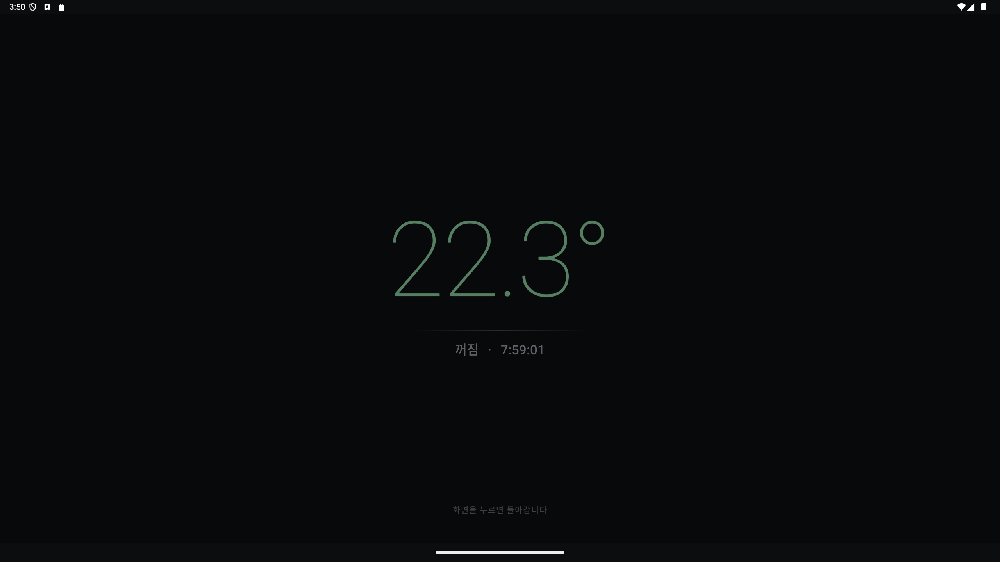
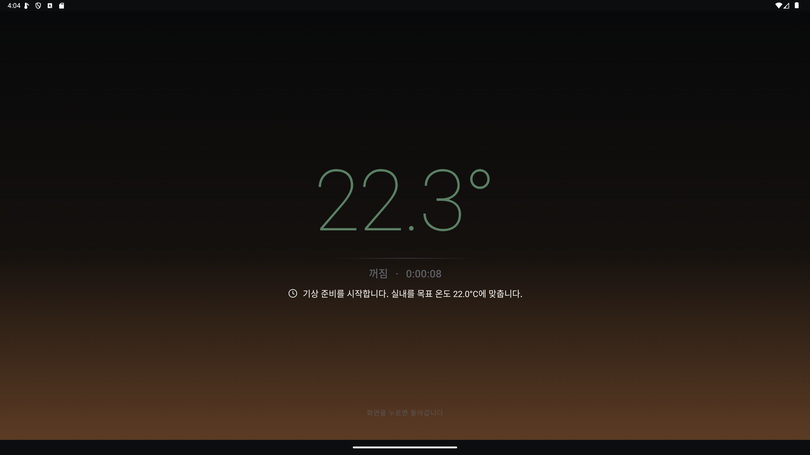
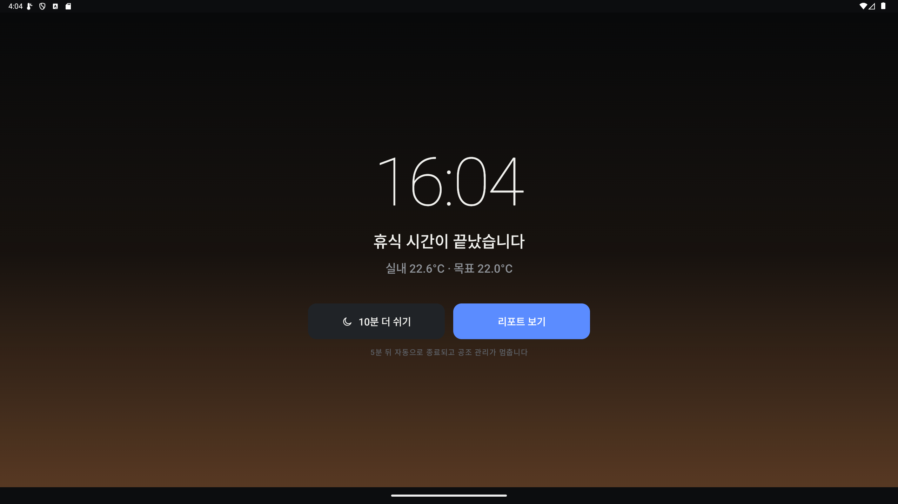

# SLEEP CLIMATE

> 차박·정차 중 맞춤형 실내 온도 관리 서비스
> 현대자동차그룹 차량용 앱 개발 공모전 출품작 (Pleos Connect)

**잠들기 전 목표 온도와 휴식 시간을 한 번 설정하면, 자는 동안 앱이 냉방·난방을 알아서 켜고 끄고, 위험할 때만 깨워 주는 차량용 앱입니다.**


---

## 왜 필요한가

차박이나 장거리 출장 중 차에서 잠들면, 밤사이 외부 기온에 따라 실내가 덥거나 추워집니다.

- 깰 때마다 직접 에어컨·히터를 켜고 꺼야 해서 **깊이 잘 수 없습니다.**
- 공조를 켜 둔 채 깊이 잠들면 **배터리 방전, 과냉·과열**이 걱정됩니다.
- 원격·예약 공조가 있어도 **취침 시간·허용 온도·종료 조건·예외 알림**을 하나로 관리하기 어렵습니다.

SLEEP CLIMATE는 이를 **'휴식 세션'** 하나로 묶습니다.

## 핵심 기능

| 기능 | 설명 |
|------|------|
| 원터치 프리셋 | 여름 차박 / 겨울 차박 / 짧은 휴식 카드 → 시작 버튼 (2번 탭) |
| 자동 공조 제어 | 허용 범위를 벗어나면 냉방·난방을 켜고, 목표 온도에 도달하면 끔 (히스테리시스) |
| 반영 확인 | 명령 전송만으로 성공 처리하지 않음 — 차량 상태로 반영을 확인해야 '반영 확인' |
| 에너지 보호 | 배터리·연료가 기준 이하이면 공조를 끄고 자동 제어를 중단한 뒤 알림 |
| 수면 화면 | 30초간 조작이 없으면 눈부심 없는 어두운 화면으로 전환, 터치하면 복귀 |
| 기상 단계 | 잠들기 → 수면 → 기상 준비. 종료 10분 전부터 허용 범위를 절반으로 좁혀 목표 온도로 미리 맞추고, 수면 화면이 일출처럼 서서히 밝아짐 |
| 기상 화면 | 종료 시각에 "10분 더 쉬기 / 리포트 보기". 응답이 없으면 5분 뒤 자동 종료해 공조를 무기한 관리하지 않음 |
| 안전 차단 | 주행 중에는 세션 시작·제어 차단, 연결 끊김·데이터 지연 시 즉시 알림 |
| 세션 결과 | 밤사이 온도 그래프, 범위 유지율, 자동 제어 횟수, 알림 요약 |
| 반려동물 동반 | 30분마다 확인 알림 (앱 알림만으로 안전을 확인할 수 없음을 명시) |

## 화면

차량 중앙 디스플레이(Pleos Devbox 17" 2560×1440 가로 화면) 기준으로 설계했습니다.
Pleos Connect의 2앱 분할 화면처럼 폭이 좁아지면 위아래 배치로 자동 전환됩니다.

| 홈 | 세션 설정 |
|----|----|
|  |  |

| 세션 진행 (자동 냉방 중) | 수면 화면 |
|----|----|
|  |  |

| 기상 준비 (일출 화면) | 기상 화면 |
|----|----|
|  |  |

| 휴식 리포트 |
|----|
|  |

- **차량 실내 렌더**: 위에서 내려다본 차량을 차량 상태 화면처럼 가는 선으로 표현합니다. 실내 빛이 온도에 따라 파랑(추움)~민트(쾌적)~주황(더움)으로 바뀌고, 공조 가동 시 송풍구에서 차박 매트 쪽으로 유선이 흐릅니다(냉방 파랑 / 난방 주황). 하단 앰비언트 라인이 공조 상태 색으로 빛납니다.
- **온도 게이지**: 1°C 눈금, 밝은 구간은 허용 범위, 흰 선은 목표 온도, 빛나는 점은 현재 실내 온도입니다.
- **디자인 원칙**: 차량 순정 인포테인먼트의 디자인 언어를 따릅니다 — 무채색 다크 배경, 얇고 큰 숫자, 선 아이콘, 의미가 있을 때만 쓰는 포인트 색, 상단 차량 상태줄(기어·배터리·외기·시계), 하위 메뉴 없이 첫 화면에서 바로 시작하는 모드 타일.

---

## 실행 방법

### APK 설치

- APK 위치: [`apk/김현중_SleepClimate_release.apk`](apk/김현중_SleepClimate_release.apk) (개인 참가 — 성명_앱이름_release)
- PC에서 설치: `adb install apk/김현중_SleepClimate_release.apk`
- 폰에서 설치: APK 파일을 폰으로 옮긴 뒤 파일 앱에서 열기 → "출처를 알 수 없는 앱 설치 허용" → 설치

> 일반 폰·에뮬레이터에는 Pleos 차량 서비스가 없으므로 앱이 이를 감지해 **자동으로 시뮬레이션 모드**로 실행합니다. 음성 명령·안내는 Pleos 음성 서비스가 없으면 폰의 기본 음성 엔진(Google 음성 인식·TTS)으로 동작합니다.

### 소스 빌드

요구사항: Android Studio (JDK 17 이상), Android SDK 34, Gradle 8.7 (wrapper 포함), Kotlin 1.9

```bash
./gradlew :app:assembleDebug        # 디버그 APK
./gradlew :app:testDebugUnitTest    # 단위 테스트
./gradlew :app:assembleRelease      # 릴리스 APK (keystore.properties 필요)
```

- `local.properties`에 Android SDK 경로(`sdk.dir`)가 필요합니다. Android Studio로 열면 자동 생성됩니다.
- 릴리스 서명 정보(`keystore.properties`, `*.jks`)는 저장소에 포함하지 않습니다.

### 시연 방법

1. 앱 실행 → 홈 하단 **자동 제어 시뮬레이션** 켜기(Pleos 서비스가 없는 기기는 자동으로 켜짐) → 시나리오 선택 (여름 밤 30°C / 겨울 밤 -3°C / 배터리 부족)
2. **여름 차박** 카드 → 휴식 시간 **시연 3분** 선택 → **세션 시작** (시연 3분은 시뮬레이션 모드에서만 표시)
3. 실내 온도가 허용 범위를 넘으면 냉방이 자동으로 켜지고(유선 애니메이션), 목표 온도에 도달하면 꺼집니다.
4. 30초 뒤 수면 화면으로 전환 → 종료 45초 전 기상 준비(일출 화면) → 종료 시 기상 화면
5. **리포트 보기** → 온도 그래프와 자동 제어 기록 확인

> 시뮬레이션은 가상 차량 데이터로 동작하며 실제 차량을 제어하지 않습니다. 화면에 '시뮬레이션'으로 표시되며, 시연을 위해 온도 변화 속도(5초 = 수 분)를 압축했습니다.

---

## 테스트 환경 및 필요한 설정

| 항목 | 내용 |
|------|------|
| 테스트 기기 | Android Emulator (API 36) — 2560×1440 가로 240dpi(Devbox 화면 재현), 1080×2400 세로(폰) |
| 최소 사양 | Android API 28 이상 (Pleos Connect 요구사항) |
| 권한 | Pleos 차량 권한(CAR_CLIMATE·CONTROL_CAR_CLIMATE·CAR_ENERGY·CAR_DRIVE), 알림, 마이크(음성 명령 시) |
| 차량 데이터 | Pleos Connect 차량·에뮬레이터: Vehicle SDK 실제 데이터 / 그 외 기기: 시뮬레이션 자동 전환 |
| 단위 테스트 | 28개 — 자동 제어 규칙, 기상 단계, 알림·쿨다운, 음성 명령 해석, 온도 시뮬레이터 |

Pleos Connect Emulator에서 차량 권한이 거부되면 SDK가 `need Permission`을 반환하므로, 개발 환경에서는 권한을 부여한 뒤 실행합니다.

```bash
adb shell pm grant com.sleepclimate.app pleos.car.permission.CAR_CLIMATE
adb shell pm grant com.sleepclimate.app pleos.car.permission.CONTROL_CAR_CLIMATE
adb shell pm grant com.sleepclimate.app pleos.car.permission.CAR_ENERGY
adb shell pm grant com.sleepclimate.app pleos.car.permission.CAR_DRIVE
```

---

## Pleos Connect SDK 연동 현황

사용 SDK (Maven `https://nexus-playground.pleos.ai/repository/maven-releases/`)

| SDK | 버전 | 앱에서 쓰는 기능 |
|-----|------|------------------|
| Vehicle | 2.3.2 | 실내 온도 `getHvacTemperatureCurrent`, 설정 온도 `getHvacTemperature`, 공조 상태 `getHvacPowerState`·`getHvacAcState`, 공조 제어 `setHvacPower`·`setHvacAc`·`setHvacAuto`·`setHvacTemperature`, 배터리 `getEvBatteryStateOfCharge`, 연료 `getFuelPercent`, 기어 `getCurrentGearSelectionState`(주차 판단) |
| SpeechToText | 3.3.1 | 음성 명령 인식 (HYBRID 모드, 한국어) |
| TextToSpeech | 3.3.1 | 음성 안내 (휴식 시작, 위험 알림, 기상, 명령 응답) |

- 지원 여부는 `checkHvacTemperatureCurrentCapabilities`·`checkHvacPowerCapabilities`·`checkHvacTemperatureCapabilities`로 먼저 확인하고, **확인된 기능만 활성화**합니다 (읽기만 가능하면 알림 모드, 제어까지 가능하면 자동 제어).
- 모든 SDK 호출에 제한 시간을 두어, 차량 서비스가 응답하지 않으면 '데이터 없음'으로 처리하고 성공으로 표시하지 않습니다.
- 구현: [`PleosVehicleRepository`](app/src/main/java/com/sleepclimate/app/data/vehicle/PleosVehicleRepository.kt), [`SpeechEngines`](app/src/main/java/com/sleepclimate/app/voice/SpeechEngines.kt)

### 음성 명령·안내

화면 오른쪽 위 마이크 버튼을 누르고 말하면 됩니다.

| 말하기 예 | 동작 |
|-----------|------|
| "여름 차박 시작해줘" / "추워서 이제 잘게" / "낮잠 좀 잘래" | 상황에 맞는 프리셋으로 바로 휴식 시작 (설정 화면 생략) |
| "22도로 맞춰줘" / "온도 좀 올려줘" / "너무 더워" | 휴식 중 목표 온도 변경 (±0.5°C) |
| "지금 몇 도야" / "남은 시간 알려줘" / "배터리 얼마나 남았어" | 음성으로 상태 안내 |
| "10분만 더 잘게" / "휴식 끝내줘" / "화면 어둡게 해줘" | 연장 / 종료 / 수면 화면 |

음성 안내는 휴식 시작, 기상, 그리고 **깨워야 하는 알림**(배터리 부족·자동 제어 중단·주행 감지·연결 끊김·온도 이탈 알림 모드)에서만 나옵니다. 자동 제어가 정상 동작할 때는 수면을 방해하지 않도록 조용히 둡니다.

## 기술 구조

```
UI (Jetpack Compose, 와이드/분할 화면 대응)
 ├─ HomeScreen · SetupScreen · RunningScreen · AlertsScreen · ResultScreen
 └─ CabinView(차량 실내 애니메이션) · TemperatureDial · TempChart
        │ StateFlow
ViewModel (HomeViewModel, SessionViewModel)
        │
Domain  MonitorSessionUseCase — 자동 제어 규칙 · 알림 · 반영 확인 · 에너지 보호
        │
Data    SwitchableVehicleRepository
         ├─ PleosVehicleRepository      ← Pleos Vehicle SDK 2.3.2
         └─ SimulatedVehicleRepository  ← CabinThermalSimulator (시연용, 차량 서비스가 없으면 자동 전환)
Voice   VoiceAssistant — Pleos STT/TTS 3.3.1 (없으면 Android 기본 음성 엔진)
        VoiceCommandParser → VoiceCommandHandler
        SessionRepository — 세션·알림·제어 기록·온도 기록
        NotificationHelper — 세션 채널(낮음) / 경고 채널(높음)
```

### 자동 제어 규칙

- 실내 온도 > 허용 상한 → 냉방 켜기 / 실내 온도 < 허용 하한 → 난방 켜기
- 냉방 중 목표 온도 이하, 난방 중 목표 온도 이상 → 공조 끄기
- 반영 확인 대기 중인 같은 명령은 재전송하지 않음, 30초 안에 반영을 확인하지 못하면 실패 처리
- 실패 3회 초과 시 자동 제어를 멈추고 직접 조작 안내 (무한 재시도 금지)
- 배터리·연료 기준 이하 → 공조 끄기 + 이번 세션 자동 제어 중단 + 알림
- 동일 유형 알림은 2분 쿨다운 (연결 끊김·데이터 지연은 즉시)
- 기상 단계(종료 전 최대 10분, 짧은 세션은 1/4)에는 허용 범위를 절반(최소 ±0.5°C)으로 좁혀 목표 온도로 미리 맞춤

---

## 심사 기준 대응

| 평가 항목 | SLEEP CLIMATE |
|-----------|---------------|
| 차량특화성 | 정차·주차 상태에서만 동작하는 차량 내 휴식 시나리오, 차량 온도·공조·배터리·기어 데이터와 결합, 차량 중앙 디스플레이 전용 UI |
| 창의성 | '공조 버튼'이 아닌 '휴식 세션' 단위 관리, 자는 동안 자동 냉난방 + 위험할 때만 깨우는 흐름, 잠들기·수면·기상 단계와 기상 전 사전 온도 맞춤, 수면·일출 화면 |
| 기술 활용성 | Pleos Vehicle SDK(공조 조회·제어, 배터리·연료, 기어) + SpeechToText·TextToSpeech SDK를 핵심 기능에 사용, Capability 확인 후 기능 활성화, 명령 반영 확인·재시도 제한·에너지 보호, 단위 테스트 28개 |
| 사업성 | 차박·캠핑, 장거리 출장·여행, 반려동물 동반 이용자 대상. 프리셋·세션 리포트로 반복 사용 유도 |

## 개발 원칙

- SDK에서 확인되지 않은 기능은 UI에 노출하지 않음
- 명령 전송 ≠ 성공: 차량 상태로 반영을 확인한 명령만 성공으로 기록
- 무한 재시도 금지: 최대 3회 후 사용자 알림으로 전환
- 주차 상태가 아니면 제어 차단
- 반려동물 시나리오: 안전을 보장한다는 표현 없이 확인 안내만 제공
- 앱은 차량의 공식 안전 기능을 대체하지 않음
